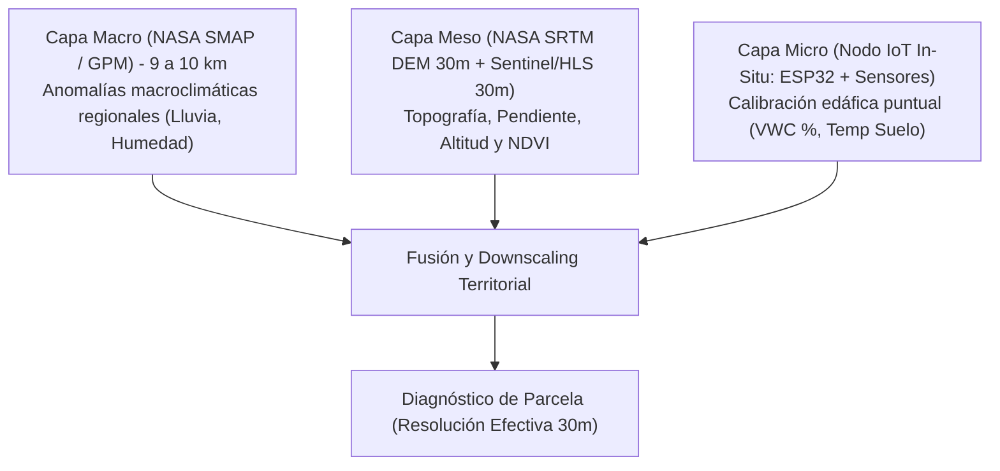
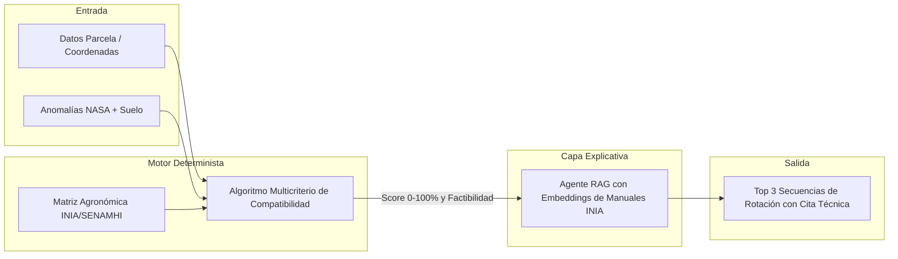

# Terraquipu: Arquitectura, Hoja de Ruta Táctica y Contratos de Integración

> **Ecosistema de Inteligencia Territorial y Regeneración Edáfica en los Andes**  
> *Desarrollado para el NASA Space Apps Challenge / Sprint de 48 Horas*

[](https://terraquipu.github.io/terraquipu-web/)
[-0284c7?style=for-the-badge)](https://terraquipu.github.io/terraquipu-web/)

👉 **Acceso directo a la plataforma en producción:** [https://terraquipu.github.io/terraquipu-web/](https://terraquipu.github.io/terraquipu-web/)

---

## 1. Núcleo del Reto: Salud del Suelo y Rotación Regenerativa

* **El Problema Central:** El reto de la NASA prioriza la **salud del suelo** y las **estrategias de rotación de cultivos**. La rotación no debe presentarse como un plan de contingencia secundario, sino como el **mecanismo principal de adaptación y regeneración edáfica** frente a El Niño.
* **Lógica Agronómica Andina:**
  * Tras sequías o estrés térmico por El Niño, el suelo queda desestructurado y con déficit hídrico.
  * La rotación **Papa $\rightarrow$ Quinua** o **Papa $\rightarrow$ Tarwi / Haba (leguminosas)**:
    1. Rompe el ciclo biológico de plagas endémicas (como el *gorgojo de los Andes* y la *polilla de la papa*).
    2. Fija nitrógeno biológico atmosférico al suelo (hasta 80–120 kg N/ha en el caso del Tarwi).
    3. Optimiza la eficiencia de uso del agua residual (la quinua requiere 300–450 mm vs. 600–800 mm de la papa).
* **Entregable Visual en el MVP:** Secuencia multi-campaña interactiva (`Campaña 1 [Papa] -> Campaña 2 [Tarwi/Leguminosa] -> Campaña 3 [Quinua] -> Cobertura/Descanso`), graficando la evolución del balance hídrico y la recuperación del carbono orgánico y nitrógeno del suelo.

---

## 2. Resolución de la "Trampa de Resolución": Arquitectura Downscaling + Ground-Truthing

Un píxel satelital de **NASA SMAP (9 km)** o **GPM (10 km)** abarca múltiples pisos altitudinales en los Andes (de valle quechua a 2,800 m s. n. m. hasta puna a 4,200 m s. n. m.). La respuesta técnica ante el jurado se sustenta en tres capas de resolución:



1. **Capa Macro (NASA SMAP / GPM - 9 a 10 km):** Detección de la anomalía climática regional (ej. 30% menos precipitación comparada con la climatología histórica de 20 años).
2. **Capa Meso (NASA SRTM DEM 30m + HLS/MODIS 30m/250m):** Ponderación física mediante altitud, pendiente y orientación de ladera. Una ladera empinada a 3,800 m drena y pierde humedad mucho más rápido que un fondo de valle a 3,200 m.
3. **Capa Micro (Telemetría de Campo / Emulador Arduino - 100% Software):**  
   Terraquipu es una plataforma **100% de software**. Para la validación en tierra (*ground-truthing*), el sistema integra un pipeline de ingesta compatible con microcontroladores Arduino/ESP32 y estaciones edáficas. Durante el MVP, los datos de sensores de humedad capacitiva y temperatura de suelo se alimentan a través de emuladores de telemetría y datasets de campo calibrados, permitiendo probar la corrección del sesgo satelital de forma ágil y sin dependencias de circuitos físicos en el evento.

---

## 3. Arquitectura de Software: Híbrida y Confiable

Para garantizar que el sistema nunca invente ni alucine recomendaciones agronómicas críticas:



* **Capa 1: Motor Multicriterio Determinista (Ciencia de Datos + Ing. Ambiental):**  
  Función matemática auditable que evalúa requerimientos hídricos (mm), temperatura base, heladas y pH frente a las condiciones del terreno, generando un índice de viabilidad objetivo (0% a 100%).
* **Capa 2: Agente Explicativo con RAG (Sistemas / IA):**  
  Toma la secuencia ganadora del motor determinista y consulta manuales técnicos indexados del INIA y SENAMHI para formular explicaciones contextualizadas y con base bibliográfica verificable.

---

## 4. División Táctica de Roles (Sprint de 48 Horas - 6 Integrantes)

| Rol | Responsabilidad en el Hackathon | Entregable Clave para el Demo | Dependencias / Conexión |
| :--- | :--- | :--- | :--- |
| **Ing. Ambiental** | Elaboración de la matriz agronómica andina, fenología, requerimientos hídricos, tolerancia edáfica y reglas de rotación según manuales INIA/SENAMHI. | Archivo `crop_matrix.json` validado con umbrales exactos por cultivo y fase de desarrollo. | Entrega a: **Ciencia de Datos** y **Sistemas 1**. |
| **Ciencia de Datos** | Extracción y procesamiento de datos NASA (POWER, SMAP, SRTM), integración de SoilGrids y programación del algoritmo determinista de scoring multicriterio. | Pipeline en Python (`scoring_engine.py`) que consume coordenadas y devuelve `territorial_diagnosis.json`. | Recibe de: **Ing. Ambiental**. Entrega a: **Sistemas 1**. |
| **Ing. Software IoT / Telemetría** | Desarrollo del emulador de telemetría de sensores Arduino/ESP32, datasets sintéticos de calibración edáfica y pipeline de streaming de datos de campo hacia la API (100% Software). | Generador y emulador de telemetría (`mock_telemetry.py`) publicando datos calibrados de suelo (`iot_telemetry.json`) a la API. | Entrega a: **Sistemas 1**. |
| **Sistemas 1 (Geo-Backend)** | Base de datos geoespacial (PostgreSQL/PostGIS), arquitectura de endpoints REST en FastAPI/Node, ingesta de telemetría y ejecución del motor multicriterio. | API desplegada con endpoints `/api/v1/diagnose`, `/api/v1/recommend` y `/api/v1/telemetry`. | Conecta a: **Ciencia de Datos**, **Electrónica** y **Frontend**. |
| **Sistemas 2 (Frontend GIS)** | Dashboard interactivo con mapa Mapbox/Leaflet (capas DEM, precipitación, anomalía), selector de parcelas y visualizador temporal de rotaciones. | Aplicación web fluida que en 3 clics selecciona parcela, grafica anomalías y visualiza el plan de rotación. | Consume endpoints de: **Sistemas 1**. |
| **Sistemas 3 (IA / RAG & Pitch)** | Indexación vectorial de PDFs técnicos (INIA/SENAMHI), agente RAG explicativo, estructura de presentación/pitch y producción del video demo (30s). | Módulo RAG que cita artículos del INIA en las recomendaciones y diapositivas finales del pitch. | Se integra con: **Sistemas 1** y apoya en la narrativa global. |

---

## 5. Estructura de Repositorios en GitHub (`Terraquipu`)

Para evitar conflictos de merge en Git durante el sprint, la organización debe estructurarse en 4 repositorios funcionales independientes más el perfil institucional:

1. **`terraquipu-web` (Frontend):** Next.js / React, Tailwind CSS, Mapbox GL / Leaflet, visualizador de línea de tiempo agronómica.
2. **`terraquipu-api` (Backend & RAG):** FastAPI / Express con PostGIS, endpoints de telemetría IoT, orquestación del scoring y pipeline RAG (LangChain / LlamaIndex / Gemini).
3. **`terraquipu-data` (Data Science & Agronomía):** Notebooks de Jupyter, scripts de extracción de NASA POWER / SoilGrids, `crop_matrix.json` y el core del algoritmo matemático.
4. **`terraquipu-iot` (Emulador Arduino & Telemetría - 100% Software):** Generadores de telemetría, datasets de prueba de sensores de suelo (JSON/CSV), simulador de streaming hacia la API y referencia de integración para microcontroladores Arduino/ESP32.
5. **`.github` (Perfil de Organización):** Contiene `profile/README.md` con el diagrama de arquitectura en 3 capas, video demo embebido y la presentación del equipo.

---

## 6. Open APIs Investigadas para Ingesta Rápida (Sin Llaves Complejas)

Durante un hackathon de 48 horas no se debe perder tiempo en aprobaciones lentas de tokens. Estas tres APIs abiertas y gratuitas resuelven todo el pipeline de datos:

### A. NASA POWER API (Meteorología y Agroclimatología Satelital)
* **Comunidad:** Agroclimatología (`community=AG`).
* **Variables Clave:** `T2M` (temp media), `T2M_MAX`, `T2M_MIN`, `PRECTOTCORR` (precipitación corregida bias), `RH2M` (humedad relativa).
* **Endpoint Directo (JSON):**
  ```text
  GET https://power.larc.nasa.gov/api/temporal/daily/point?parameters=T2M,T2M_MAX,T2M_MIN,PRECTOTCORR,RH2M&community=AG&longitude=-71.967&latitude=-13.532&start=20230101&end=20231231&format=JSON
  ```
* **Ventaja:** No requiere registro ni API key. Devuelve series históricas para calcular anomalías de El Niño de inmediato.

### B. ISRIC SoilGrids v2.0 REST API (Propiedades Edáficas Mundiales a 250m)
* **Propiedades Clave:** `phh2o` (pH en agua), `soc` (carbono orgánico g/kg), `nitrogen` (nitrógeno total), `clay`, `sand`, `silt`, `cec` (capacidad de intercambio catiónico).
* **Profundidades Estándar:** `0-5cm`, `5-15cm`, `15-30cm`.
* **Endpoint Directo (JSON):**
  ```text
  GET https://rest.isric.org/soilgrids/v2.0/properties/query?lon=-71.967&lat=-13.532&property=phh2o&property=soc&property=nitrogen&property=clay&depth=0-5cm&depth=5-15cm&value=mean
  ```
* **Ventaja:** Permite diagnosticar la salud inicial del suelo andino sin necesidad de análisis de laboratorio previo.

### C. Open-Meteo Elevation & Soil Moisture API (Topografía y Respaldo)
* **Elevación (SRTM 90m):**
  ```text
  GET https://api.open-meteo.com/v1/elevation?latitude=-13.532&longitude=-71.967
  ```
* **Humedad del Suelo y Evapotranspiración ($ET_0$):**
  ```text
  GET https://api.open-meteo.com/v1/forecast?latitude=-13.532&longitude=-71.967&hourly=soil_moisture_0_7cm,reference_evapotranspiration
  ```
* **Ventaja:** Latencia menor a 100 ms y sin clave de acceso, ideal para downscaling topográfico y balance hídrico en tiempo real.

---

## 7. Contratos JSON de Integración

Estos esquemas estandarizados desacoplan el trabajo de los 6 integrantes desde la primera hora del hackathon.

### Contrato 1: Matriz Agronómica (`crop_matrix.json`)
*Generado por: Ing. Ambiental | Consumido por: Ciencia de Datos y Backend.*

```json
{
  "crops": [
    {
      "crop_id": "papa_nativa",
      "common_name": "Papa Nativa (Variedad Huayro / Canchan)",
      "scientific_name": "Solanum tuberosum andigenum",
      "family": "Solanaceae",
      "cycle_days": 150,
      "water_requirement_mm": {
        "min": 500,
        "optimal": 650,
        "max": 800
      },
      "thermal_limits_celsius": {
        "base_temp": 6.0,
        "optimal_min": 10.0,
        "optimal_max": 18.0,
        "frost_tolerance": -1.5
      },
      "altitude_range_masl": {
        "min": 2800,
        "max": 4100
      },
      "soil_tolerance": {
        "ph_min": 5.0,
        "ph_optimal": 6.2,
        "ph_max": 7.5,
        "drainage": "good",
        "salinity_tolerance": "low"
      },
      "soil_impact": {
        "nitrogen_balance_kg_ha": -70,
        "organic_matter_demand": "high",
        "pest_break_score": 1
      },
      "favorable_successors": ["tarwi", "haba", "quinua"],
      "unfavorable_successors": ["papa_nativa", "tomate"]
    },
    {
      "crop_id": "tarwi",
      "common_name": "Tarwi / Chocho",
      "scientific_name": "Lupinus mutabilis",
      "family": "Fabaceae (Leguminosa)",
      "cycle_days": 180,
      "water_requirement_mm": {
        "min": 350,
        "optimal": 500,
        "max": 650
      },
      "thermal_limits_celsius": {
        "base_temp": 5.0,
        "optimal_min": 8.0,
        "optimal_max": 16.0,
        "frost_tolerance": -3.0
      },
      "altitude_range_masl": {
        "min": 2900,
        "max": 3900
      },
      "soil_tolerance": {
        "ph_min": 5.5,
        "ph_optimal": 6.8,
        "ph_max": 8.0,
        "drainage": "moderate",
        "salinity_tolerance": "moderate"
      },
      "soil_impact": {
        "nitrogen_balance_kg_ha": 95,
        "organic_matter_demand": "low",
        "pest_break_score": 5
      },
      "favorable_successors": ["papa_nativa", "maiz", "cebada"],
      "unfavorable_successors": ["tarwi"]
    },
    {
      "crop_id": "quinua",
      "common_name": "Quinua (Variedad Pasankalla / Salcedo INIA)",
      "scientific_name": "Chenopodium quinoa",
      "family": "Amaranthaceae",
      "cycle_days": 140,
      "water_requirement_mm": {
        "min": 280,
        "optimal": 400,
        "max": 550
      },
      "thermal_limits_celsius": {
        "base_temp": 4.0,
        "optimal_min": 8.0,
        "optimal_max": 20.0,
        "frost_tolerance": -4.0
      },
      "altitude_range_masl": {
        "min": 2500,
        "max": 4000
      },
      "soil_tolerance": {
        "ph_min": 5.0,
        "ph_optimal": 6.5,
        "ph_max": 8.5,
        "drainage": "moderate",
        "salinity_tolerance": "high"
      },
      "soil_impact": {
        "nitrogen_balance_kg_ha": -25,
        "organic_matter_demand": "moderate",
        "pest_break_score": 4
      },
      "favorable_successors": ["tarwi", "haba", "papa_nativa"],
      "unfavorable_successors": ["quinua"]
    }
  ]
}
```

---

### Contrato 2: Telemetría IoT & Calibración de Suelo (`iot_telemetry.json`)
*Generado por: Ing. Electrónico (ESP32 o `mock_telemetry.py`) | Consumido por: Backend.*

```json
{
  "device_id": "terraquipu-node-cusco-01",
  "firmware_version": "v1.2.0-esp32",
  "timestamp": "2026-11-10T10:30:00Z",
  "location": {
    "latitude": -13.5321,
    "longitude": -71.9675,
    "elevation_masl": 3410.5
  },
  "readings": {
    "soil_moisture_vwc_percent": 18.4,
    "soil_temperature_celsius": 12.3,
    "air_temperature_celsius": 16.8,
    "air_humidity_percent": 42.1,
    "battery_level_percent": 88
  },
  "calibration_factors": {
    "smap_bias_offset": -3.2,
    "soil_texture_profile": "franco-arcilloso",
    "status": "calibrated"
  }
}
```

---

### Contrato 3: Diagnóstico Territorial de Parcela (`territorial_diagnosis.json`)
*Generado por: Ciencia de Datos / Backend | Consumido por: Frontend y Motor de Recomendación.*

```json
{
  "plot_id": "parcela-chinchero-sector-b",
  "location": {
    "latitude": -13.5321,
    "longitude": -71.9675,
    "department": "Cusco",
    "province": "Urubamba",
    "district": "Chinchero",
    "elevation_masl": 3410,
    "ecological_floor": "Quechua Superior",
    "slope_degrees": 8.5
  },
  "climate_context": {
    "enso_phase": "El Niño Moderado",
    "historical_annual_rainfall_mm": 720.0,
    "projected_season_rainfall_mm": 510.0,
    "rainfall_anomaly_percent": -29.2,
    "frost_risk_level": "medium",
    "heat_wave_days_expected": 14
  },
  "soil_health_profile": {
    "source": "SoilGrids v2.0 + In-Situ IoT",
    "ph": 6.1,
    "organic_carbon_g_kg": 18.2,
    "total_nitrogen_g_kg": 1.4,
    "texture": {
      "clay_percent": 24,
      "sand_percent": 41,
      "silt_percent": 35
    },
    "current_moisture_vwc_percent": 18.4,
    "soil_health_index_100": 62
  }
}
```

---

### Contrato 4: Recomendación Multicriterio y Explicación RAG (`rotation_recommendation.json`)
*Generado por: Backend (Scoring) + Sistemas 3 (Agente RAG) | Consumido por: Frontend Dashboard.*

```json
{
  "diagnosis_ref_id": "parcela-chinchero-sector-b",
  "generated_at": "2026-11-10T10:35:00Z",
  "current_culture_history": ["papa_nativa"],
  "recommended_strategies": [
    {
      "rank": 1,
      "strategy_title": "Regeneración Rápida con Leguminosa Andina",
      "suitability_score_100": 91,
      "soil_health_projection_delta": "+22%",
      "rotation_sequence": [
        {
          "campaign_index": 1,
          "season": "2026-2027 (El Niño)",
          "crop_id": "tarwi",
          "variety": "Tarwi Andenes INIA",
          "water_balance_status": "surplus",
          "projected_nitrogen_gain_kg_ha": 95,
          "pest_break_success": true
        },
        {
          "campaign_index": 2,
          "season": "2027-2028 (Recuperación)",
          "crop_id": "quinua",
          "variety": "Quinua Pasankalla",
          "water_balance_status": "optimal",
          "projected_nitrogen_gain_kg_ha": -25,
          "pest_break_success": true
        },
        {
          "campaign_index": 3,
          "season": "2028-2029 (Campaña Principal)",
          "crop_id": "papa_nativa",
          "variety": "Canchan INIA",
          "water_balance_status": "optimal",
          "projected_nitrogen_gain_kg_ha": -70,
          "pest_break_success": false
        }
      ],
      "rag_explanation": {
        "summary": "Debido a un déficit de precipitaciones proyectado del 29.2% por El Niño y un suelo desgastado tras la última cosecha de papa nativa, no se aconseja resembrar tubérculos consecutivamente. La rotación inmediata hacia Tarwi (Lupinus mutabilis) aprovecha su bajo requerimiento hídrico (350–500 mm), fija hasta 95 kg de N/ha y rompe el ciclo del gorgojo andino.",
        "citations": [
          {
            "institution": "INIA Perú",
            "document": "Manual Técnico N° 14: Manejo Integrado y Rotación del Cultivo de Tarwi en Zonas Altoandinas",
            "year": 2022,
            "relevant_excerpt": "La inclusión de leguminosas en valles interandinos reduce en un 75% la incidencia de plagas del suelo para la subsecuente siembra de papa."
          },
          {
            "institution": "SENAMHI",
            "document": "Boletín Agroclimático Nacional - Impactos de El Niño en la Sierra Sur",
            "year": 2024
          }
        ]
      }
    }
  ]
}
```

---

## 8. Propuesta de Valor y Pitch del Proyecto

* **Diagnóstico del Problema:** Frente a eventos climáticos extremos como El Niño, los agricultores andinos carecen de herramientas a escala de parcela que traduzcan la información satelital en decisiones de siembra. El monocultivo continuado o decisiones a ciegas provocan degradación severa de nutrientes, agotamiento de la humedad del suelo y pérdida catastrófica de cosechas.
* **Pregunta Reto:** *¿Cómo podemos empoderar a los agricultores andinos para planificar rotaciones de cultivos que regeneren la salud del suelo y blinden su producción ante el cambio climático y El Niño?*
* **Propósito (Pitch de 1 Línea):** Democratizar la inteligencia satelital de la NASA y la ciencia del suelo para transformar la rotación de cultivos en el escudo de resiliencia más poderoso de los Andes.
* **Objetivo General:** Desarrollar un sistema de inteligencia territorial y soporte a decisiones que integre observaciones satelitales de la NASA (GPM, SMAP, SRTM), propiedades edáficas de alta resolución (SoilGrids), calibración in-situ con sensores IoT y recomendaciones agronómicas oficiales validadas (INIA/SENAMHI) mediante una arquitectura híbrida determinista y explicativa (RAG).
